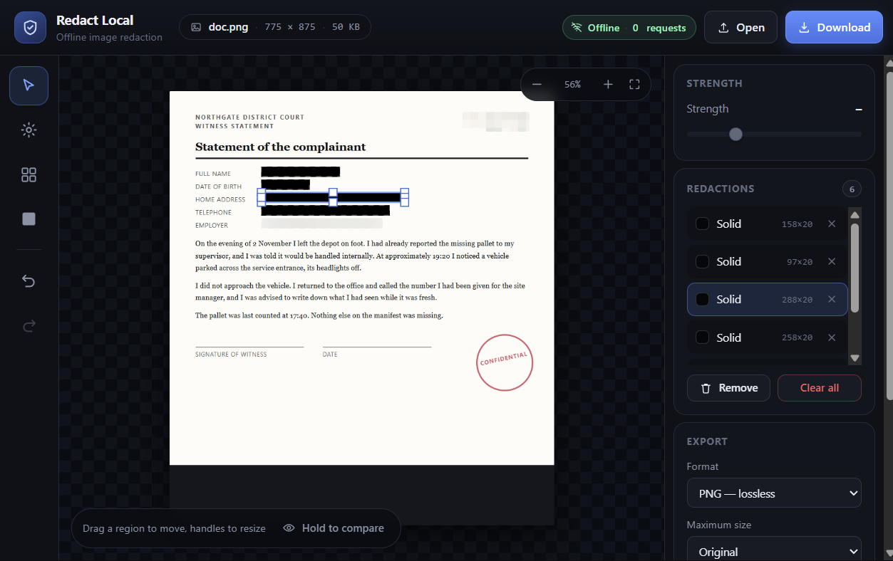

# Redact Local

**Blur or black out anything in an image — without uploading it anywhere.**

A single-page, dependency-free redaction tool that runs entirely in your browser. No server, no account,
no analytics, no network code at all. Built for people who handle images they cannot afford to leak:
journalists, researchers, caseworkers, lawyers, and sources.



---

## Live demo

**[Open Redact Local](https://YOUR-USERNAME.github.io/redact-local/)** — replace `YOUR-USERNAME` with your
GitHub account once Pages is enabled (see [Publishing](#publishing)).

> The hosted copy is for convenience. GitHub Pages records the IP address of every visitor, so for
> genuinely sensitive material **download the repository and open `index.html` from your own disk**
> instead. The app is identical, and it works with the network cable unplugged.

## Quick start

1. Download this repository (`Code` → `Download ZIP`) and unzip it, or `git clone` it.
2. Open `index.html` in Chrome, Edge, Firefox or Safari.
3. Drop an image onto the window — or click **Open**, or paste with `Ctrl`+`V`.
4. Pick a tool, drag a rectangle over anything that must not be seen.
5. **Download redacted copy.**

No install, no build step, no dependencies. It works from a USB stick, offline, forever.

## Using it

| Action | How |
| --- | --- |
| Load an image | Drop it on the window, click **Open**, or paste with `Ctrl`+`V` |
| Draw a redaction | Pick a tool, then drag a rectangle over the image |
| Adjust a region | `V`, then drag the region to move it, or drag its 8 handles to resize |
| Change strength | Use the slider — it edits the selected region when one is selected |
| Undo / redo | `Ctrl`+`Z` / `Ctrl`+`Shift`+`Z` |
| Delete | Select a region and press `Delete`, or use the list on the right |
| Zoom / pan | Wheel to zoom, `Space`+drag or middle-drag to pan, `0` to fit |
| Compare | Hold **Hold to compare** to reveal the original |
| Export | **Download redacted copy** (`Ctrl`+`S`) or **Copy image** |

Tools: `B` blur · `P` pixelate · `S` solid black · `V` select.

Export options: PNG (lossless), JPEG or WebP with a quality slider, and optional downscaling to
2560 / 2048 / 1280 px on the long edge.

## Choose the right redaction

| Tool | Reversible? | Use for |
| --- | --- | --- |
| **Solid** | No | Names, faces, ID numbers, addresses — anything that must never leak |
| **Pixelate** | Sometimes | Context where the exact wording is not sensitive |
| **Blur** | Often | The weakest option; the app warns below a 12 px radius |

Gaussian blur and light pixelation can be partially reversed by machine-learning reconstruction.
If a leak would harm someone, use **Solid**.

Redact a generous margin too: text just outside a blurred area usually stays readable.

## Privacy model

Everything is client-side. There is no backend to send anything to, and the page cannot make a request
even if it wanted to.

- **Strict Content-Security-Policy** — `default-src 'none'; connect-src 'none'`. Only this folder's own
  `styles.css` and `app.js` may load; every outbound connection is refused by the browser.
- **No network primitives.** `fetch`, `XMLHttpRequest`, `WebSocket`, `EventSource`, `sendBeacon`,
  `Worker` and `RTCPeerConnection` are replaced with throwing stubs at startup. The
  **Offline · N requests** badge in the header counts blocked attempts; it stays at 0.
- **No persistence.** No cookies, `localStorage`, `sessionStorage`, IndexedDB or service worker.
  Closing the tab discards the image.
- **No third-party code.** No CDNs, fonts, analytics, or badge images.
- **Metadata is stripped.** Exports are re-drawn into a fresh canvas and re-encoded, so EXIF, GPS
  coordinates, camera model, timestamps and XMP blocks are discarded. Only visible pixels survive.

### Verify it yourself

1. Open DevTools → **Network**, then load, redact and export an image. The request list stays empty.
2. Or disconnect from the network — nothing changes.
3. View source: there are three files, and none of them can open a socket.

## Design notes

- **Preview and export share one render path**, so what you see is exactly what gets written. There is no
  separate "preview quality" that could hide a leak.
- Blur samples an expanded source region and then clips to the redaction, so the edge of a region never
  keeps a sharp remnant of the original pixels.
- Exports re-render from the original bitmap at full resolution; overlapping regions never compound or
  degrade the rest of the image.
- Large images are downscaled only for the on-screen preview (4096 px cap); exports stay full resolution.
- Redactions are drawn from the original image, not from the already-redacted composite, so a second
  region can never sample a neighbouring blur.

## Files

```
index.html   markup, strict CSP, accessible controls
styles.css   dark UI, responsive down to ~820px
app.js       canvas engine, tools, history, export, network lockdown
assets/      screenshots used in this README
```

## Limits

- Images above 160 MB are rejected; very large photos (60 MP+) may be slow to redact.
- The clipboard button needs a browser that supports `ClipboardItem`; otherwise use Download.
- Redaction happens in this tab's memory. If your device or browser is compromised, this page cannot
  protect you — work on a trusted machine, and redact *before* you send anything anywhere.

## Publishing

This repository is ready to serve from GitHub Pages with no build step:

1. Create a repository and upload the contents of this folder (keep `index.html` at the root).
2. **Settings → Pages → Source:** *Deploy from a branch* → Branch `main`, folder `/ (root)` → **Save**.
3. Wait for the deploy, then open `https://YOUR-USERNAME.github.io/REPO-NAME/`.
4. Replace `YOUR-USERNAME` in the link at the top of this README (and in the repository's *Website*
   field) with your account name.

## License

[MIT](LICENSE) — use it, fork it, ship it inside your organisation.

The demo document in `assets/` is fabricated for illustration; no real person or case is depicted.
